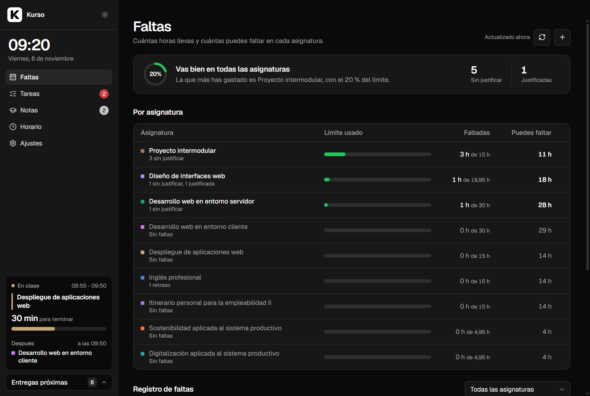
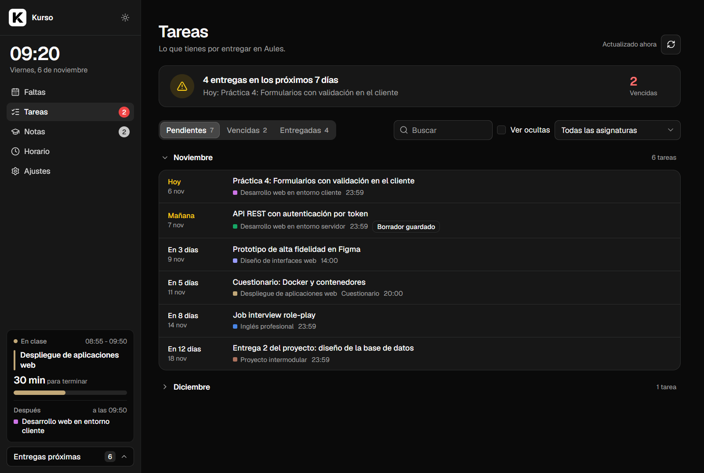
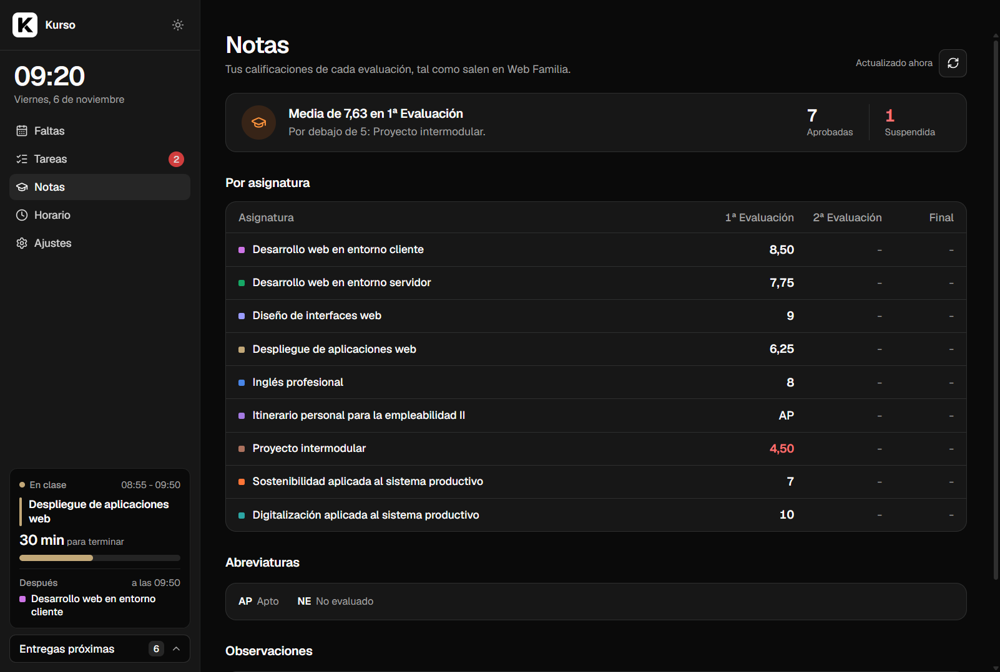
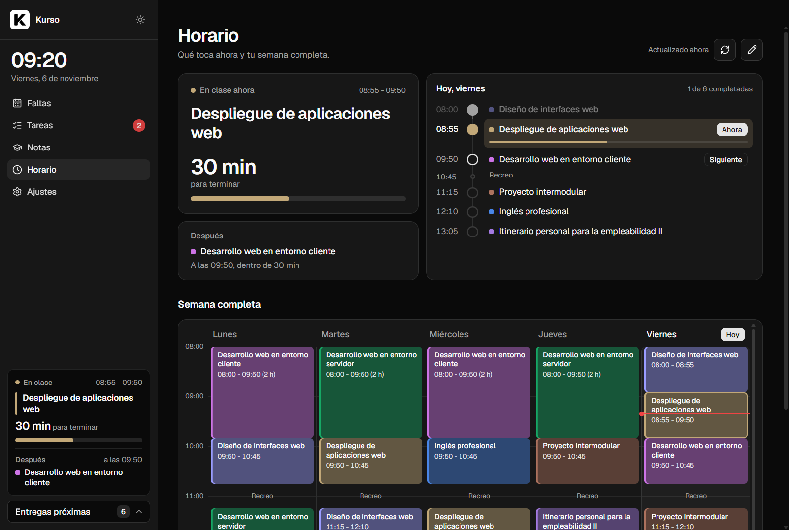
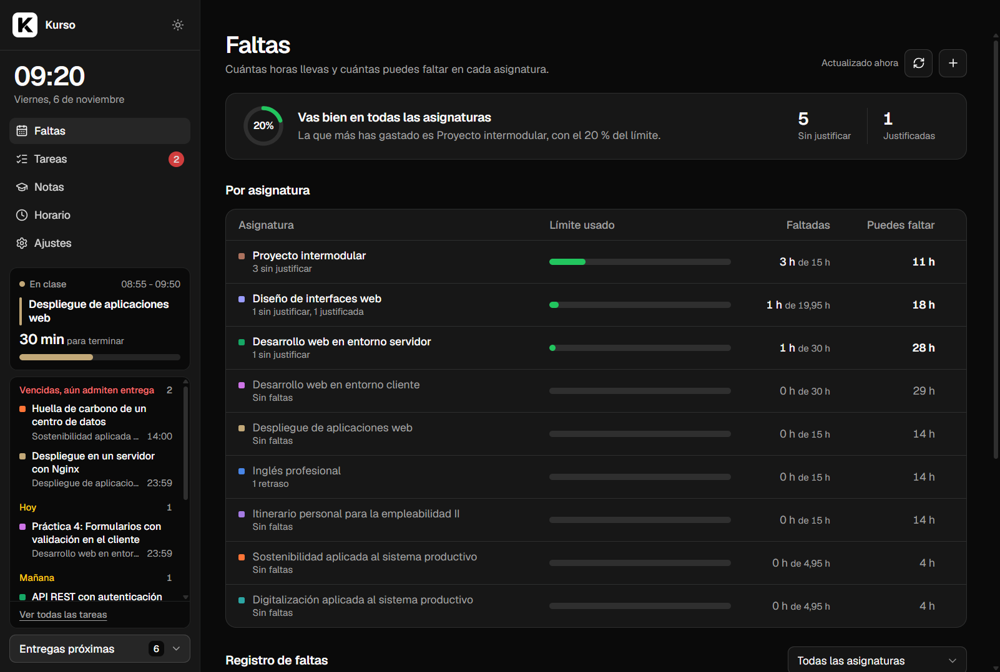
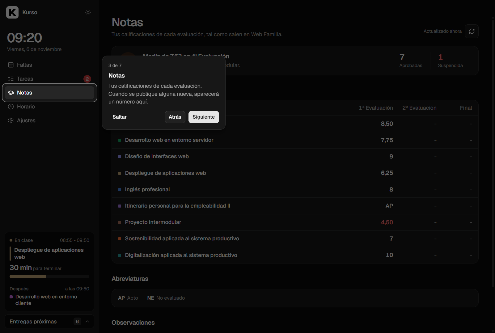

<p align="center">
  
</p>

<h1 align="center">Kurso</h1>

<p align="center">
  <b>Absences, assignments, grades and timetable for your vocational course, in one desktop app.</b><br>
  For students in the Valencian Community who use Ítaca (Web Familia) and Aules.
</p>

<p align="center">
  <a href="https://github.com/caastilloo/kurso/actions/workflows/tests.yml"></a>
  <a href="LICENSE"></a>
  
  <a href="README.md"></a>
</p>

<p align="center">
  
</p>

> **Finished project.** Kurso does what I needed and I don't plan to keep extending it. The code is free (MIT): if you want to adapt it to your school or give it your own style, fork it.

The app itself is in Spanish, because it's built for Spanish vocational training (FP) students.

## Contents

- [Why it exists](#why-it-exists)
- [What it does](#what-it-does)
- [Installation](#installation)
- [Try it without accounts](#try-it-without-accounts)
- [Privacy and security](#privacy-and-security)
- [How it works](#how-it-works)
- [Development](#development)
- [Limitations](#limitations)
- [Disclaimer](#disclaimer)
- [Credits](#credits)

## Why it exists

In a Spanish vocational course (FP), missing 15% of a module's hours means losing continuous assessment. Ítaca records absences, Aules holds assignments, and Web Familia shows the timetable and grades, but nothing tells you at a glance **how many hours you have left**, **what is due this week** or **which class is on right now**. Kurso puts all of that in one window.

## What it does

### Absences
Reads your absences from Web Familia and works out, module by module, how many hours you've missed and **how many more you can miss** before reaching the limit. It warns you when one is getting close, tells excused absences and late arrivals apart (and lets you decide whether they count), and lets you add absences by hand.

### Assignments
Brings in the assignments from all your Aules courses: pending, overdue but still open, and submitted with their grade. They're grouped by month and can be searched, filtered by module and hidden. Each one opens its Aules page in your browser.

<p align="center"></p>

### Grades
Shows your grades for each term as soon as the school publishes them on Web Familia, with the average, failed modules, the abbreviation legend and the teachers' notes. When a new grade appears, it lets you know.

<p align="center"></p>

### Timetable
The class that's on now, how long is left and what comes next, today's schedule and the whole week in a colour-coded calendar. The timetable is read from Web Familia; if your school doesn't use it, you can **type it in by hand** (with a photo of your timetable next to it to copy from).

<p align="center"></p>

### Always in view
The sidebar shows the time, the current class and an **upcoming deadlines** panel that expands without leaving the screen you're on.

<p align="center"></p>

### Nothing to set up
- **Modules are picked up automatically** from your Web Familia enrolment, electives included.
- **Total hours are estimated** from your weekly timetable (each weekly session is about 33 hours a year) and can be corrected.
- Guided sign-in the first time and a short **tour** of each section.
- Light and dark mode, and a compact layout for narrow windows.

<p align="center"></p>

## Installation

1. Download `Kurso Setup x.y.z.exe` from the [latest release](https://github.com/caastilloo/kurso/releases/latest).
2. Run it. The installer isn't code-signed, so Windows may show *"Windows protected your PC"*: click **More info → Run anyway**.
3. The first time you open Kurso, connect your Aules and Web Familia accounts (or skip the one you don't use).

Requires Windows 10 or 11.

## Try it without accounts

The project includes a **demo mode** with made-up data for a 2nd-year web development student. It doesn't connect to anything:

```bash
npm install
npm run demo
```

## Privacy and security

- **Everything stays on your computer**, in `%LOCALAPPDATA%\Kurso`. No servers of its own, no analytics.
- **Your Aules password is never stored**: it's used once to get an access token.
- The Web Familia password is stored (the site has no tokens), **encrypted with Windows DPAPI**: only your Windows user, on that machine, can decrypt it. Secrets reach the encryption step through standard input, never as arguments visible in the process list.
- Web Familia pages are only **read**, just as your browser would, and the session is closed afterwards. Cookies are only ever sent to Web Familia.
- **Sign out** (in Settings) deletes credentials and data from the computer.

## How it works

```
┌────────────────────────── Electron ───────────────────────────┐
│  Window (Chromium, sandboxed)  ←──HTTP──→  Express server      │
│  public/: HTML + CSS + JS, no                 127.0.0.1         │
│  frameworks, no build step                   server.js + src/   │
└────────────────────────────────────────────────┬───────────────┘
                                                 │ HTTPS
                     ┌───────────────────────────┴───────────────┐
                     │ Aules (Moodle)          Web Familia (Ítaca)│
                     │ mobile app API          HTML pages         │
                     └────────────────────────────────────────────┘
```

| Part | What it does |
|---|---|
| `electron/` | Desktop window. Starts the server in the same process, opens external links in the browser and denies permissions it doesn't need. |
| `server.js` | Local API on `127.0.0.1`. It only answers the app itself (it checks `Host` and `Origin`, so another website open in your browser can't call it) and serves the UI with a strict Content Security Policy. |
| `src/aules.js` | Moodle client using the official mobile app web service: courses, assignments, submission status and calendar events. |
| `src/itaca.js` | Web Familia has no API, so Kurso keeps a session like a browser does and reads the HTML: absences, timetable, grades and modules. If a page isn't recognised, it says so and keeps the last data: "the site changed" is never mistaken for "you have no absences". |
| `src/asignaturas.js` | Builds the module list from the enrolment and estimates hours from the timetable. |
| `src/vault.js` | Credential encryption with DPAPI. |
| `src/store.js` | JSON storage with atomic, queued writes. |
| `public/` | Framework-free JavaScript UI with its own design system based on shadcn/ui. |

Some decisions:

- **No UI framework.** It's a small app with a handful of screens; modern JavaScript and CSS are enough, and there's nothing to build.
- **Strict CSP.** Not a single inline style is allowed: dynamic colours are applied from JavaScript.
- **Offline tests.** The logic (limits, dates, Web Familia parsers, timetable, grades) is tested with `node:test` against sample pages, and the server is tested by actually starting it on a temporary folder. No test contacts Aules or Web Familia.

## Development

Requires Node.js 22 or later and Windows (credential encryption uses DPAPI).

```bash
npm install
npm start          # open the app
npm run demo       # open the app with made-up data
npm test           # run the tests
npm run dist       # build the installer into dist/
```

Layout:

```
electron/     desktop window
server.js     local API
src/          server logic (Aules, Web Familia, absences, timetable, grades…)
public/       user interface
scripts/      demo mode
test/         tests
```

## Limitations

- **Windows only**, because of DPAPI.
- **Only schools using Ítaca and Aules** (Valencian Community). Elsewhere you can still type the timetable by hand, but absences and grades depend on Web Familia.
- **Still to be verified with real data**: the grades format (written before any grades were published), excused absences and late arrivals, and other schools' pages. If something can't be read, Kurso says so instead of showing wrong data.
- Total hours are an estimate based on the timetable; the official figures are in each module's syllabus.

## Disclaimer

Kurso is a personal project and **not an official app**. It is not affiliated with the Generalitat Valenciana or its Department of Education. Aules, Ítaca and Web Familia belong to their respective owners. Kurso signs in with **your own account** and only reads information you can already see. Use it at your own risk.

## Credits

- Design inspired by [shadcn/ui](https://ui.shadcn.com/).
- Icons by [Lucide](https://lucide.dev/) (ISC) and the [Geist](https://vercel.com/font) typeface (SIL Open Font License).

Made by **José Ramón Castillo Amat** ([@caastilloo](https://github.com/caastilloo)) during his second year of Web Application Development.

[MIT](LICENSE) licensed.
