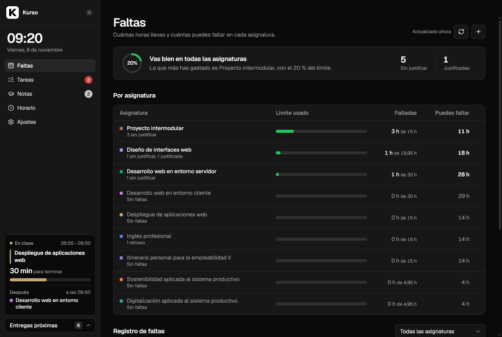
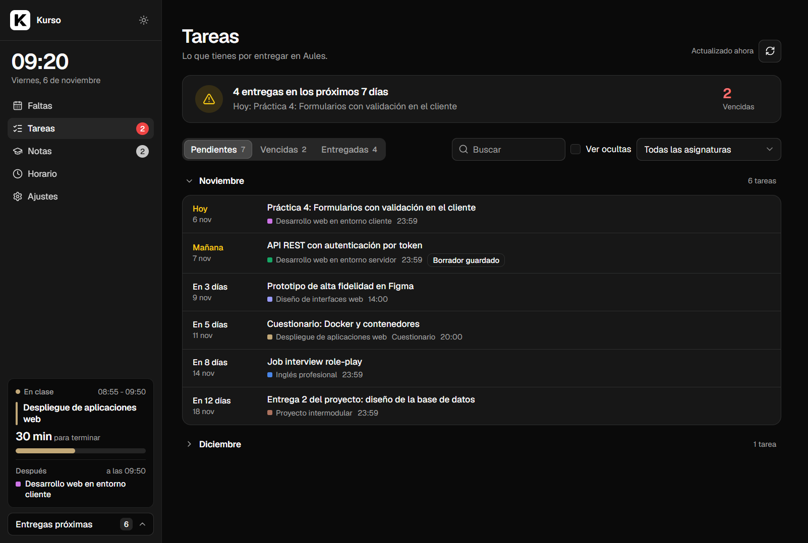
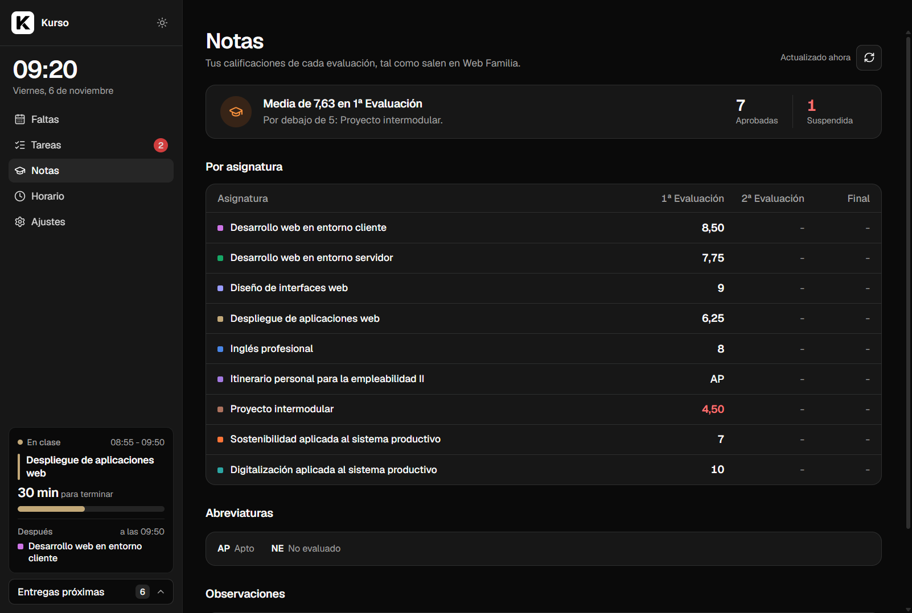
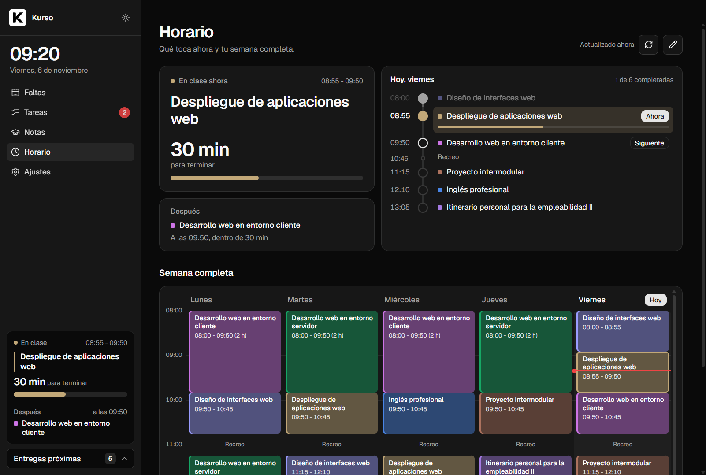
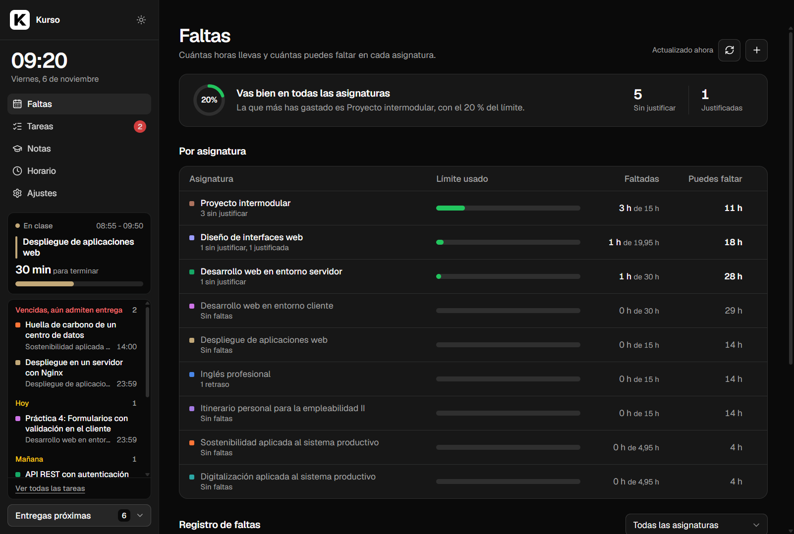
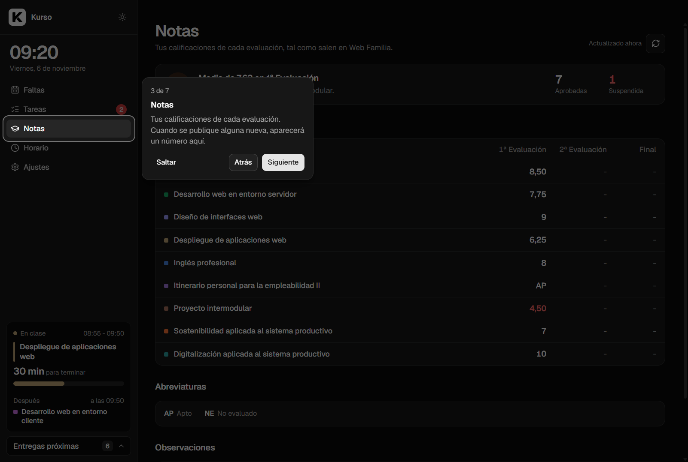

<p align="center">
  
</p>

<h1 align="center">Kurso</h1>

<p align="center">
  <b>Faltas, tareas, notas y horario de tu ciclo de FP, en una sola app de escritorio.</b><br>
  Para alumnado de la Comunitat Valenciana que usa Ítaca (Web Familia) y Aules.
</p>

<p align="center">
  <a href="https://github.com/caastilloo/kurso/actions/workflows/tests.yml"></a>
  <a href="LICENSE"></a>
  
  <a href="README.en.md"></a>
</p>

<p align="center">
  
</p>

> **Proyecto terminado.** Kurso cubre lo que necesitaba y no tengo previsto seguir ampliándolo. El código es libre (MIT): si quieres adaptarlo a tu centro o darle tu estilo, haz un fork.

## Índice

- [Por qué existe](#por-qué-existe)
- [Qué hace](#qué-hace)
- [Instalación](#instalación)
- [Probarlo sin cuentas](#probarlo-sin-cuentas)
- [Privacidad y seguridad](#privacidad-y-seguridad)
- [Cómo funciona por dentro](#cómo-funciona-por-dentro)
- [Desarrollo](#desarrollo)
- [Limitaciones](#limitaciones)
- [Aviso legal](#aviso-legal)
- [Créditos](#créditos)

## Por qué existe

En un ciclo formativo, si faltas al 15 % de las horas de un módulo pierdes la evaluación continua. Ítaca registra las faltas, Aules las entregas y Web Familia el horario y las notas, pero nada te dice de un vistazo **cuántas horas te quedan**, **qué tienes que entregar esta semana** o **qué clase toca ahora**. Kurso junta todo eso en una ventana.

## Qué hace

### Faltas
Lee tus faltas de Web Familia y calcula, asignatura por asignatura, cuántas horas llevas y **cuántas puedes faltar todavía** sin llegar al límite. Avisa cuando una se acerca al límite, distingue faltas justificadas y retrasos (y te deja decidir si cuentan), y permite añadir faltas a mano.

### Tareas
Trae las entregas de todos tus cursos de Aules: pendientes, vencidas que aún admiten entrega y entregadas con su nota. Las agrupa por meses, se pueden buscar, filtrar por asignatura y ocultar. Cada tarea abre su página de Aules en el navegador.

<p align="center"></p>

### Notas
Muestra tus calificaciones de cada evaluación en cuanto el centro las publica en Web Familia, con la media, las suspendidas, la leyenda de abreviaturas y las observaciones. Cuando aparece una nota nueva, lo avisa.

<p align="center"></p>

### Horario
La clase que toca ahora, cuánto le queda y cuál viene después, la jornada de hoy y la semana completa en un calendario de colores. El horario se lee de Web Familia; si tu centro no la usa, se puede **escribir a mano** (con una foto del horario al lado para copiarlo).

<p align="center"></p>

### Siempre a la vista
La barra lateral enseña la hora, la clase en curso y un panel de **entregas próximas** que se despliega sin cambiar de pantalla.

<p align="center"></p>

### Sin configurar nada
- **Las asignaturas salen solas** de tu matrícula en Web Familia, optativa incluida.
- **Las horas totales se estiman** con tu horario semanal (cada sesión semanal son unas 33 horas al año) y se pueden corregir.
- Registro guiado la primera vez y un **tutorial** corto por cada apartado.
- Modo claro y oscuro, y una vista compacta para ventanas estrechas.

<p align="center"></p>

## Instalación

1. Descarga el instalador `Kurso Setup x.y.z.exe` de la [última versión](https://github.com/caastilloo/kurso/releases/latest).
2. Ábrelo. Como el instalador no está firmado, Windows puede mostrar *"Windows protegió su PC"*: pulsa **Más información → Ejecutar de todas formas**.
3. Al abrir Kurso por primera vez, conecta tu cuenta de Aules y la de Web Familia (o sáltate la que no uses).

Requisitos: Windows 10 u 11.

## Probarlo sin cuentas

El proyecto incluye un **modo demostración** con datos inventados de 2º de DAW, que no se conecta a nada:

```bash
npm install
npm run demo
```

## Privacidad y seguridad

- **Todo se queda en tu ordenador**, en `%LOCALAPPDATA%\Kurso`. No hay servidores propios ni analítica.
- La **contraseña de Aules no se guarda**: solo se usa una vez para obtener un token de acceso.
- La de Web Familia sí se guarda (no ofrece tokens), **cifrada con DPAPI de Windows**: solo tu usuario de Windows, en ese equipo, puede descifrarla. Los secretos viajan al cifrado por la entrada estándar, nunca como argumentos visibles en la lista de procesos.
- De Web Familia solo se **leen** páginas, igual que haría tu navegador, y la sesión se cierra al terminar. Las cookies solo viajan a Web Familia.
- **Cerrar sesión** (en Ajustes) borra credenciales y datos del equipo.

## Cómo funciona por dentro

```
┌────────────────────────── Electron ───────────────────────────┐
│  Ventana (Chromium, sandbox)  ←──HTTP──→  Servidor Express     │
│  public/: HTML + CSS + JS sin                 127.0.0.1         │
│  frameworks ni compilación                   server.js + src/   │
└────────────────────────────────────────────────┬───────────────┘
                                                 │ HTTPS
                     ┌───────────────────────────┴───────────────┐
                     │ Aules (Moodle)          Web Familia (Ítaca)│
                     │ API de la app móvil     páginas HTML       │
                     └────────────────────────────────────────────┘
```

| Pieza | Qué hace |
|---|---|
| `electron/` | Ventana de escritorio. Arranca el servidor dentro del mismo proceso, abre los enlaces externos en el navegador y deniega permisos que no necesita. |
| `server.js` | API local en `127.0.0.1`. Solo responde a la propia app (comprueba `Host` y `Origin`, así que otra web abierta en el navegador no puede llamarla) y sirve la interfaz con una política de seguridad de contenidos estricta. |
| `src/aules.js` | Cliente de Moodle con el servicio web de la app móvil oficial: cursos, tareas, estado de cada entrega y eventos del calendario. |
| `src/itaca.js` | Web Familia no tiene API, así que Kurso mantiene una sesión como un navegador y lee el HTML: faltas, horario, notas y módulos. Si una página no se reconoce, se avisa y se conservan los últimos datos: nunca se confunde "la web ha cambiado" con "no tienes faltas". |
| `src/asignaturas.js` | Crea las asignaturas a partir de la matrícula y estima las horas con el horario. |
| `src/vault.js` | Cifrado de credenciales con DPAPI. |
| `src/store.js` | Datos en JSON con escrituras atómicas y en cola. |
| `public/` | Interfaz en JavaScript sin frameworks, con un sistema de diseño propio basado en shadcn/ui. |

Algunas decisiones:

- **Sin frameworks en la interfaz.** Es una app pequeña con pocas pantallas; JavaScript moderno y CSS bastan, y no hay que compilar nada.
- **Política de seguridad estricta (CSP).** No se permite ni un estilo en línea: los colores dinámicos se aplican desde JavaScript.
- **Pruebas sin conexión.** La lógica (límites, fechas, lectores de Web Familia, horario, notas) se prueba con `node:test` sobre páginas de ejemplo, y el servidor se prueba arrancándolo de verdad sobre una carpeta temporal. Ninguna prueba contacta con Aules ni con Web Familia.

## Desarrollo

Requisitos: Node.js 22 o superior y Windows (el cifrado de credenciales usa DPAPI).

```bash
npm install
npm start          # abre la app
npm run demo       # abre la app con datos inventados
npm test           # pruebas
npm run dist       # genera el instalador en dist/
```

Estructura:

```
electron/     ventana de escritorio
server.js     API local
src/          lógica del servidor (Aules, Web Familia, faltas, horario, notas…)
public/       interfaz
scripts/      modo demostración
test/         pruebas
```

## Limitaciones

- **Solo Windows**, por el cifrado DPAPI.
- **Solo centros con Ítaca y Aules** (Comunitat Valenciana). En otros sitios se puede usar el horario a mano, pero faltas y notas dependen de Web Familia.
- **Pendiente de verificar con datos reales**: el formato de las notas (se programó antes de que se publicara ninguna), el de faltas justificadas y retrasos, y el de otros centros. Si algo no se lee, Kurso lo dice en vez de enseñar datos incorrectos.
- Las horas totales son una estimación con el horario; las oficiales están en la programación de cada módulo.

## Aviso legal

Kurso es un proyecto personal y **no es una aplicación oficial**. No está relacionado con la Generalitat Valenciana ni con la Conselleria de Educación. Aules, Ítaca y Web Familia son servicios de sus respectivos titulares. Kurso accede con **tu propia cuenta** y solo lee la información que tú ya puedes ver. Úsalo bajo tu responsabilidad.

## Créditos

- Diseño inspirado en [shadcn/ui](https://ui.shadcn.com/).
- Iconos de [Lucide](https://lucide.dev/) (ISC) y tipografía [Geist](https://vercel.com/font) (SIL Open Font License).

Hecho por **José Ramón Castillo Amat** ([@caastilloo](https://github.com/caastilloo)) durante 2º de Desarrollo de Aplicaciones Web.

Licencia [MIT](LICENSE).
